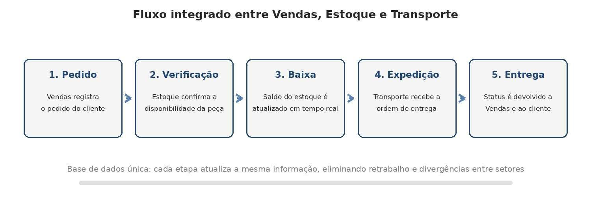

## 3. Modelagem dos Processos de Negócio

Pré-requisitos: <a href="2-Especificação.md"> Especificação do Projeto</a>

### 3.1. Modelagem da situação atual (Modelagem AS IS)

Em empresas de pequeno e médio porte do comércio de peças automotivas, os processos de estoque, vendas e transporte costumam ser executados com controles separados:

1. **Venda:** o cliente (geralmente uma oficina ou consumidor final) solicita uma peça no balcão, por telefone ou por aplicativo de mensagens. O vendedor consulta uma planilha ou um sistema de estoque não integrado — ou pergunta ao estoquista — para saber se a peça está disponível, calcula o valor e registra o pedido em outro sistema, em um caderno ou na própria conversa.
2. **Baixa no estoque:** a saída da peça é anotada pelo estoquista quando ela é separada, em momento diferente da venda. Como o saldo não é atualizado no instante do pedido, outro vendedor pode prometer a mesma peça a outro cliente.
3. **Entrega:** o vendedor avisa a logística por mensagem ou verbalmente. O responsável pela logística organiza a entrega e acompanha o motorista por telefone.
4. **Retorno ao cliente:** quando o cliente pergunta sobre a entrega, o vendedor precisa consultar a logística, que por sua vez consulta o motorista.

**Gargalos identificados:**

- **Retrabalho:** a mesma informação (cliente, peças, quantidades, endereço) é digitada em vários controles.
- **Inconsistência:** o saldo registrado diverge do saldo real porque a baixa não acontece no momento da venda.
- **Perda de informação:** a confirmação da entrega nem sempre chega ao setor de vendas.
- **Falta de visão gerencial:** o gestor não tem um ponto único para ver estoque crítico, pedidos e entregas pendentes.

> O diagrama BPMN do modelo AS-IS deve ser elaborado na ferramenta da disciplina e inserido aqui (ex.: `imagem/as-is.png`).

### 3.2. Descrição geral da proposta (Modelagem TO BE)

A proposta é que **o pedido de venda seja a informação única** que percorre os três setores, registrada uma só vez em uma base de dados compartilhada:

1. O vendedor registra o pedido no módulo de **Vendas**; o sistema mostra o saldo de cada item e calcula o total.
2. Na confirmação, o sistema **verifica a disponibilidade no Estoque** de todos os itens. Se algum não tiver saldo, a confirmação é bloqueada e nada é alterado.
3. Com saldo suficiente, o sistema realiza a **baixa automática** do estoque e registra a movimentação de saída com o pedido de origem e o usuário responsável.
4. Na mesma operação, é gerada a **ordem de entrega** no módulo de **Transporte**, com o endereço do cliente como destino.
5. O responsável pela logística registra a **saída** (com o motorista) e a **conclusão** (com a comprovação). A situação é **devolvida automaticamente ao pedido** em Vendas.

**Oportunidades de melhoria:** eliminação da redigitação entre setores; saldo sempre coerente com as vendas confirmadas; rastreabilidade de quem movimentou cada peça; consulta da entrega pelo próprio vendedor; e indicadores gerenciais calculados a partir dos registros.

**Limites da solução:** o protótipo não trata emissão de nota fiscal, contas a receber, compras de fornecedores nem roteirização automática de entregas. A proposta está alinhada ao objetivo do negócio de evitar perda de vendas por falta de informação e de reduzir custos operacionais com retrabalho.

> Os diagramas BPMN do modelo TO-BE de cada processo devem ser elaborados na ferramenta da disciplina e inseridos nas páginas de cada processo abaixo.

### 3.3. Modelagem dos processos

[PROCESSO 1 - Gestão de Estoque](./processo/processo-1-gestao-de-estoque.md "Detalhamento do Processo 1.")

[PROCESSO 2 - Registro e Confirmação de Pedido de Venda](./processo/processo-2-pedido-de-venda.md "Detalhamento do Processo 2.")

[PROCESSO 3 - Expedição e Entrega](./processo/processo-3-expedicao-e-entrega.md "Detalhamento do Processo 3.")
