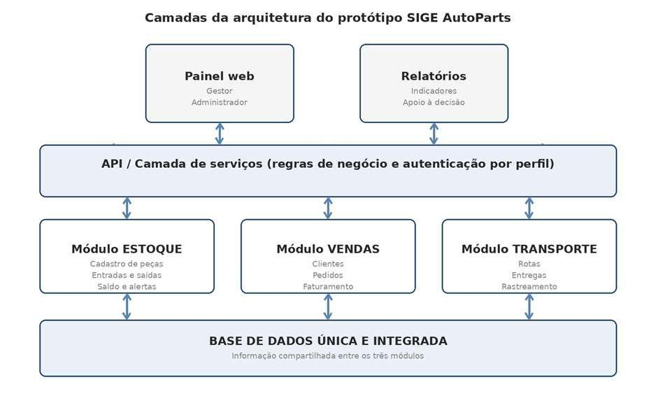
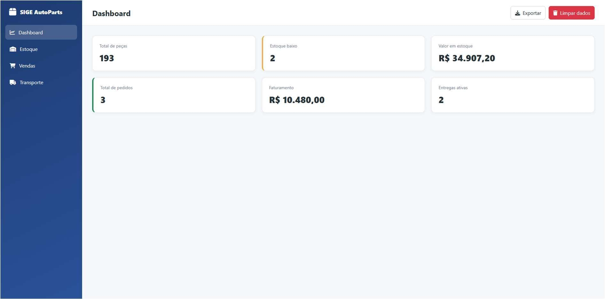
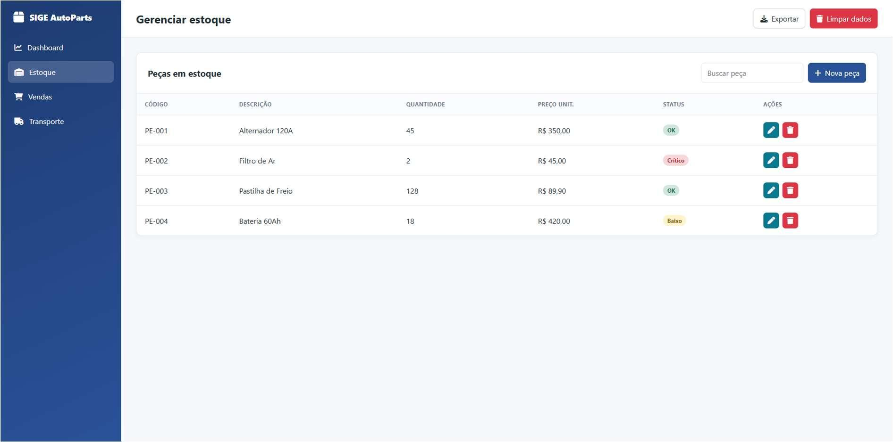
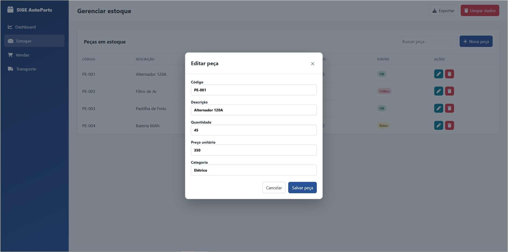
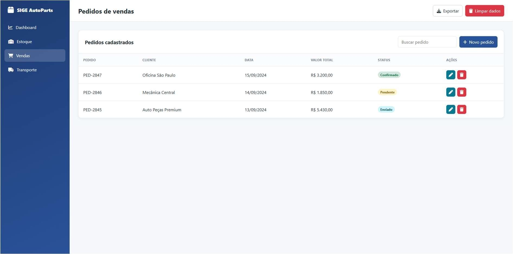
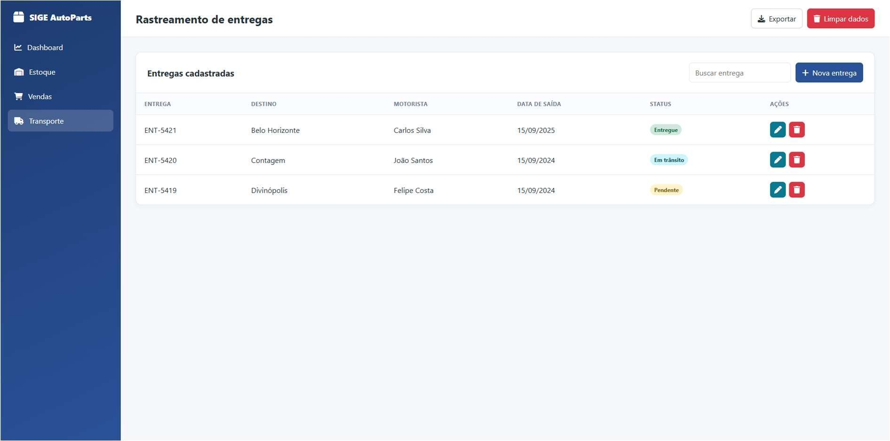
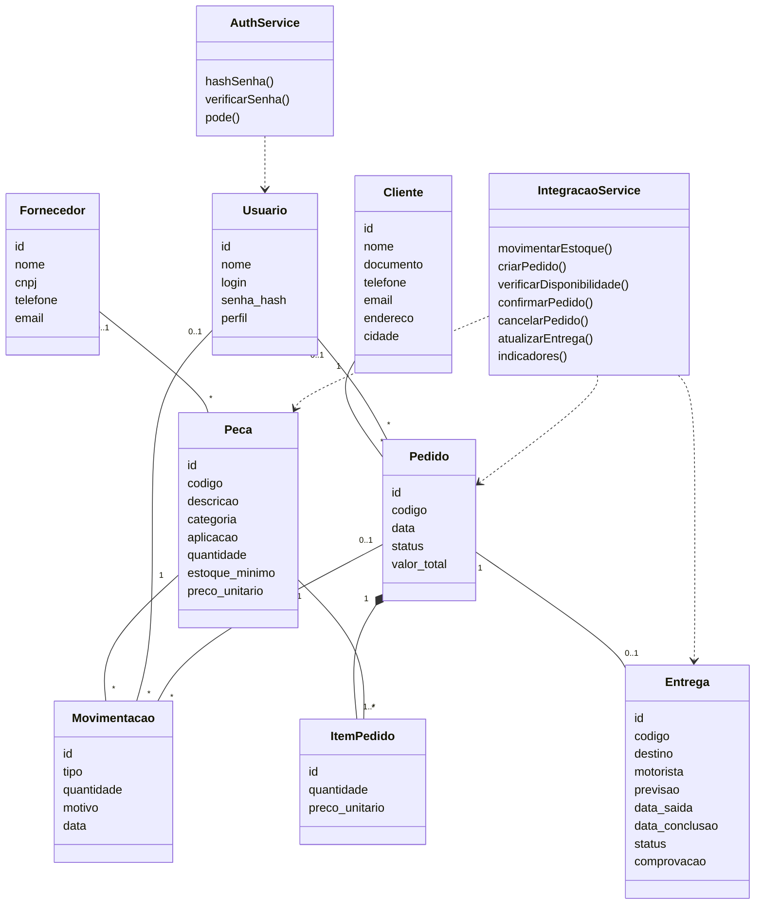
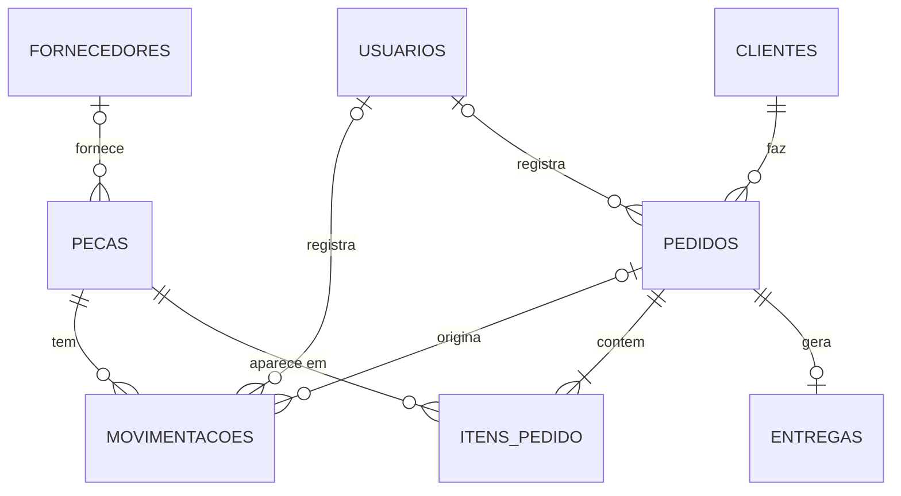

## 4. Projeto da Solução

<span style="color:red">Pré-requisitos: <a href="3-Modelagem-Processos-Negócio.md"> Modelagem do Processo de Negócio</a></span>

## 4.1. Arquitetura da solução

A solução foi organizada em **camadas**, separando a interface utilizada pelos usuários das regras de negócio e do armazenamento dos dados (BASS; CLEMENTS; KAZMAN, 2021; RNF08):

- **Camada de apresentação** — aplicação web de página única (HTML, CSS e JavaScript), responsiva, usada pelos perfis de administrador, estoque, vendas e logística, com o painel gerencial do gestor.
- **Camada de serviços** — API REST em Node.js/Express que autentica os usuários, verifica as permissões de cada perfil e aplica as regras de negócio. As regras que envolvem mais de um módulo ficam concentradas em um **serviço de integração**, que executa a confirmação do pedido (verificação de saldo, baixa, movimentação e geração da entrega) em uma única transação.
- **Camada de persistência** — banco SQLite com a **base de dados única** compartilhada pelos módulos de Estoque, Vendas e Transporte. Como o acesso aos dados está isolado nessa camada, a base pode ser migrada futuramente para um SGBD cliente-servidor (ex.: PostgreSQL) sem alterar a apresentação.



### 4.2. Protótipos de telas

O primeiro incremento (3ª etapa) foi um protótipo navegável das telas, refinado progressivamente até se tornar o sistema (prototipação evolutiva — PRESSMAN, 2011). As telas foram organizadas por módulo, e cada perfil enxerga apenas as funções necessárias à sua atividade (RF17, RNF01). O painel atende ao RF18; as telas de estoque, aos RF01 a RF05; as de vendas, aos RF06 a RF11; e as de entregas, aos RF12 a RF14 e RF16.

**Painel principal (dashboard)**



**Estoque**





**Vendas**



**Entregas**



## Diagrama de Classes

O sistema foi implementado em JavaScript com módulos de serviço (sem classes de domínio). O diagrama abaixo representa as entidades de negócio e os serviços que operam sobre elas.



### 4.3. Modelo de dados

O modelo lógico foi implementado em **oito tabelas** de uma base única (RNF03). As chaves estrangeiras vinculam cada pedido ao cliente, aos seus itens e à respectiva entrega, e restrições de verificação impedem, por exemplo, que o saldo de uma peça se torne negativo. O controle de acesso é feito pela tabela `usuarios`, cujo campo `perfil` corresponde aos papéis dos processos de negócio (admin, estoque, vendas e logística).

#### 4.3.1 Modelo ER



#### 4.3.2 Esquema Relacional

| **Tabela** | **Atributos** (PK em negrito; FK em itálico) | **Módulos que utilizam** |
|---|---|---|
| usuarios | **id**, nome, login (único), senha_hash, perfil | Todos (acesso) |
| fornecedores | **id**, nome, cnpj (único), telefone, email | Estoque |
| pecas | **id**, codigo (único), descricao, categoria, aplicacao, quantidade (≥ 0), estoque_minimo, preco_unitario, *fornecedor_id* → fornecedores | Estoque e Vendas |
| movimentacoes | **id**, *peca_id* → pecas, tipo (ENTRADA/SAIDA), quantidade (> 0), motivo, *pedido_id* → pedidos, *usuario_id* → usuarios, data | Estoque |
| clientes | **id**, nome, documento (único), telefone, email, endereco, cidade | Vendas e Transporte |
| pedidos | **id**, codigo (único), *cliente_id* → clientes, *usuario_id* → usuarios, data, status, valor_total | Vendas e Transporte |
| itens_pedido | **id**, *pedido_id* → pedidos, *peca_id* → pecas, quantidade (> 0), preco_unitario | Vendas e Estoque |
| entregas | **id**, codigo (único), *pedido_id* → pedidos (único), destino, motorista, previsao, data_saida, data_conclusao, status, comprovacao | Transporte e Vendas |

#### 4.3.3 Modelo Físico

O script de criação das tabelas está no arquivo [`código-fonte/db/schema.sql`](../código-fonte/db/schema.sql) e é executado automaticamente pela aplicação na inicialização.

```sql
-- SIGE AutoParts — modelo lógico da base de dados única
-- Compartilhada pelos módulos de Estoque, Vendas e Transporte (RNF03)

PRAGMA foreign_keys = ON;

CREATE TABLE IF NOT EXISTS usuarios (
  id          INTEGER PRIMARY KEY AUTOINCREMENT,
  nome        TEXT    NOT NULL,
  login       TEXT    NOT NULL UNIQUE,
  senha_hash  TEXT    NOT NULL,                       -- RNF02: scrypt + salt
  perfil      TEXT    NOT NULL CHECK (perfil IN ('admin','estoque','vendas','logistica'))
);

CREATE TABLE IF NOT EXISTS fornecedores (
  id        INTEGER PRIMARY KEY AUTOINCREMENT,
  nome      TEXT NOT NULL,
  cnpj      TEXT UNIQUE,
  telefone  TEXT,
  email     TEXT
);

CREATE TABLE IF NOT EXISTS pecas (
  id              INTEGER PRIMARY KEY AUTOINCREMENT,
  codigo          TEXT    NOT NULL UNIQUE,
  descricao       TEXT    NOT NULL,
  categoria       TEXT,
  aplicacao       TEXT,                                -- veículos compatíveis (RF04)
  quantidade      INTEGER NOT NULL DEFAULT 0 CHECK (quantidade >= 0),
  estoque_minimo  INTEGER NOT NULL DEFAULT 5 CHECK (estoque_minimo >= 0),
  preco_unitario  REAL    NOT NULL CHECK (preco_unitario >= 0),
  fornecedor_id   INTEGER REFERENCES fornecedores(id) ON DELETE SET NULL
);

-- RNF09: rastreabilidade de entradas e saídas
CREATE TABLE IF NOT EXISTS movimentacoes (
  id          INTEGER PRIMARY KEY AUTOINCREMENT,
  peca_id     INTEGER NOT NULL REFERENCES pecas(id) ON DELETE CASCADE,
  tipo        TEXT    NOT NULL CHECK (tipo IN ('ENTRADA','SAIDA')),
  quantidade  INTEGER NOT NULL CHECK (quantidade > 0),
  motivo      TEXT,
  pedido_id   INTEGER REFERENCES pedidos(id) ON DELETE SET NULL,
  usuario_id  INTEGER REFERENCES usuarios(id),
  data        TEXT    NOT NULL DEFAULT (datetime('now','localtime'))
);

CREATE TABLE IF NOT EXISTS clientes (
  id         INTEGER PRIMARY KEY AUTOINCREMENT,
  nome       TEXT NOT NULL,
  documento  TEXT UNIQUE,                               -- CPF/CNPJ
  telefone   TEXT,
  email      TEXT,
  endereco   TEXT,
  cidade     TEXT
);

CREATE TABLE IF NOT EXISTS pedidos (
  id           INTEGER PRIMARY KEY AUTOINCREMENT,
  codigo       TEXT    NOT NULL UNIQUE,
  cliente_id   INTEGER NOT NULL REFERENCES clientes(id),
  usuario_id   INTEGER REFERENCES usuarios(id),
  data         TEXT    NOT NULL DEFAULT (datetime('now','localtime')),
  status       TEXT    NOT NULL DEFAULT 'Pendente'
               CHECK (status IN ('Pendente','Confirmado','Em entrega','Concluído','Cancelado')),
  valor_total  REAL    NOT NULL DEFAULT 0
);

CREATE TABLE IF NOT EXISTS itens_pedido (
  id              INTEGER PRIMARY KEY AUTOINCREMENT,
  pedido_id       INTEGER NOT NULL REFERENCES pedidos(id) ON DELETE CASCADE,
  peca_id         INTEGER NOT NULL REFERENCES pecas(id),
  quantidade      INTEGER NOT NULL CHECK (quantidade > 0),
  preco_unitario  REAL    NOT NULL
);

CREATE TABLE IF NOT EXISTS entregas (
  id              INTEGER PRIMARY KEY AUTOINCREMENT,
  codigo          TEXT    NOT NULL UNIQUE,
  pedido_id       INTEGER NOT NULL UNIQUE REFERENCES pedidos(id) ON DELETE CASCADE,
  destino         TEXT    NOT NULL,
  motorista       TEXT,
  previsao        TEXT,
  data_saida      TEXT,
  data_conclusao  TEXT,
  status          TEXT    NOT NULL DEFAULT 'Pendente'
                  CHECK (status IN ('Pendente','Em trânsito','Entregue')),
  comprovacao     TEXT
);
```

### 4.4. Tecnologias

A escolha das tecnologias considerou três critérios: aderência à arquitetura em camadas, ausência de custos de licenciamento e facilidade de execução do protótipo em ambiente acadêmico.

| **Dimensão**   | **Tecnologia**  | **Uso no projeto** |
| ---            | ---             | --- |
| SGBD           | SQLite (módulo `node:sqlite`) | Base de dados única em um arquivo, com chaves estrangeiras e transações (RNF03, RNF04) |
| Front end      | HTML5 + CSS3 + JavaScript | Interface responsiva para computador e celular (RNF06, RNF07) |
| Back end       | Node.js 22 + Express 4 | API REST, regras de negócio e controle de acesso por perfil |
| Segurança      | scrypt (módulo `crypto` do Node.js) | Senhas com hash e salt (RNF02) |
| Testes         | node:test | Testes automatizados das regras de integração e de acesso |
| Versionamento  | Git + GitHub | Código, documentação e versões (tags v0.1.0, v1.0.0) |
| Deploy         | Execução local (`npm start`); ambiente de demonstração previsto para a Mostra Tecnológica | |

**Percurso de uma interação:** o usuário aciona uma tela no navegador → o JavaScript da página chama a API REST com o token de sessão → o middleware de autenticação identifica o usuário e verifica a permissão do perfil → a rota chama o serviço de negócio, que lê/grava na base SQLite dentro de uma transação → a API devolve JSON → a tela é atualizada.
