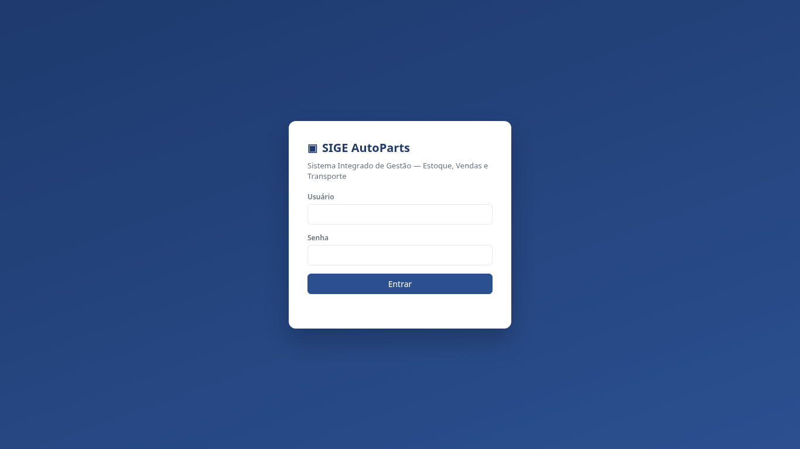
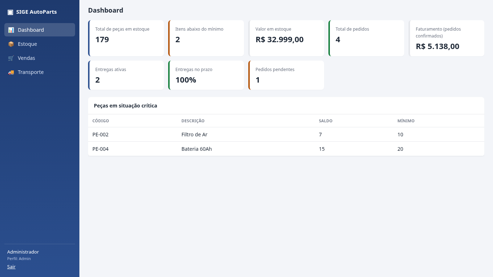
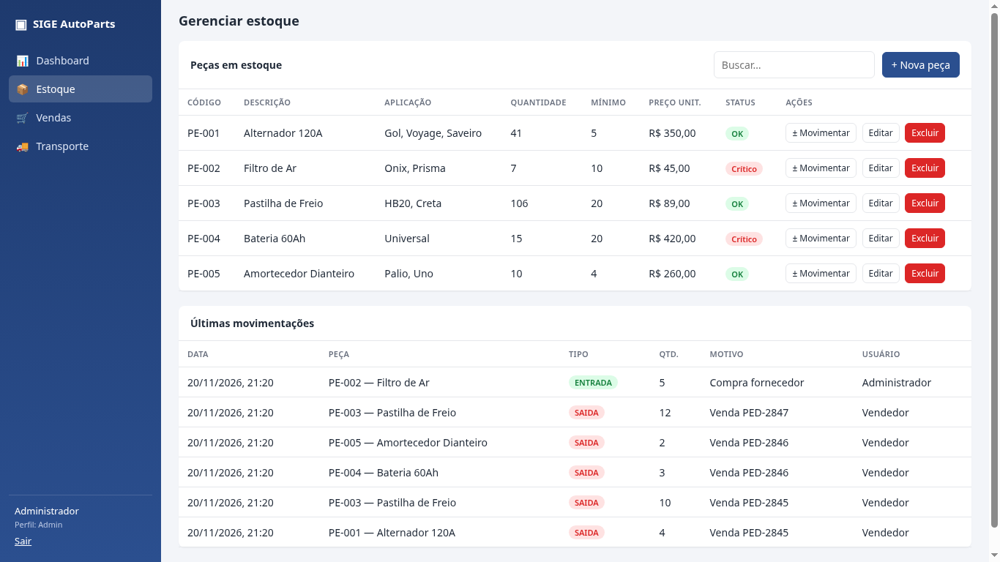
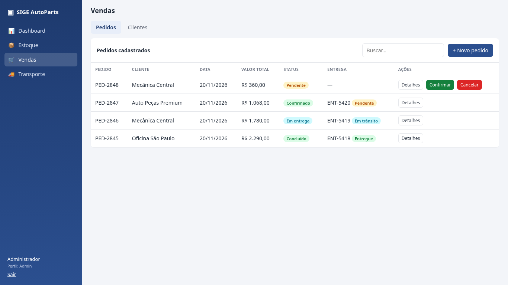
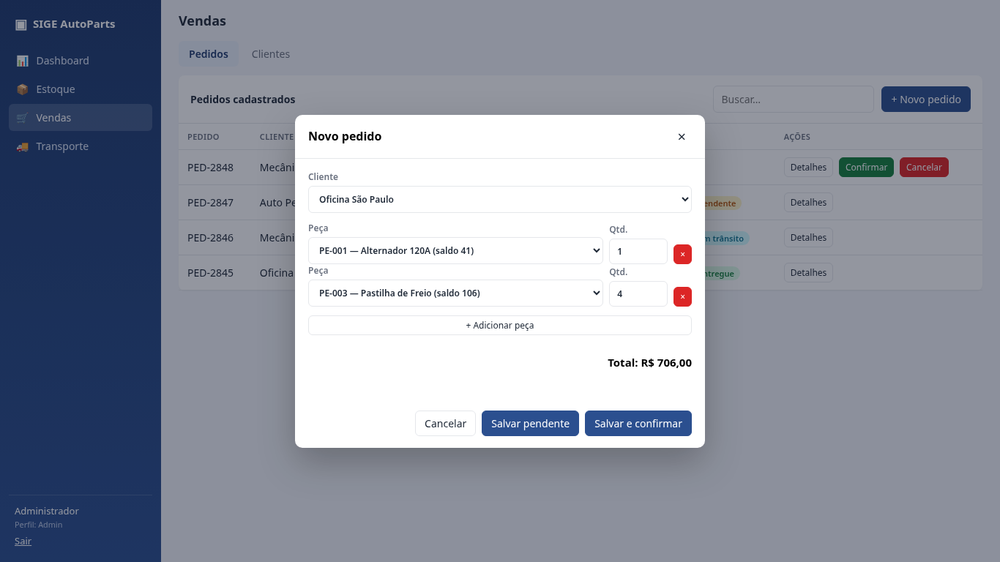
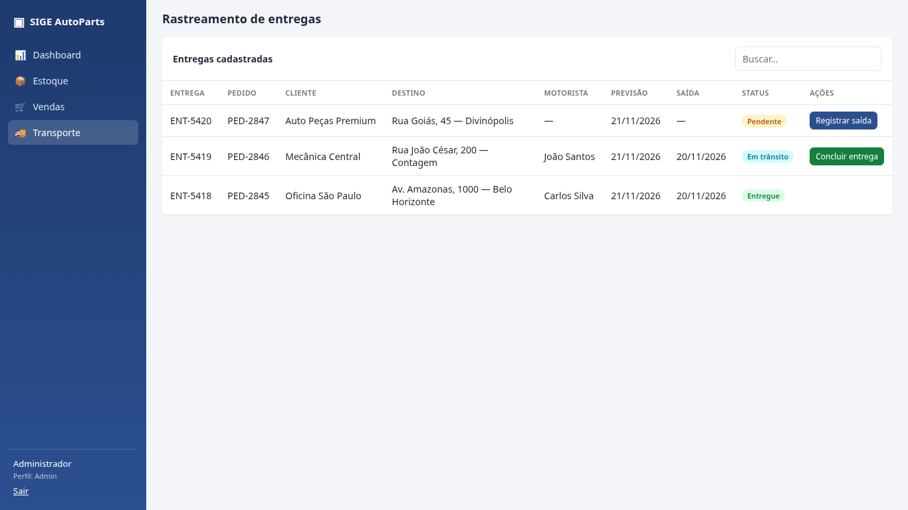
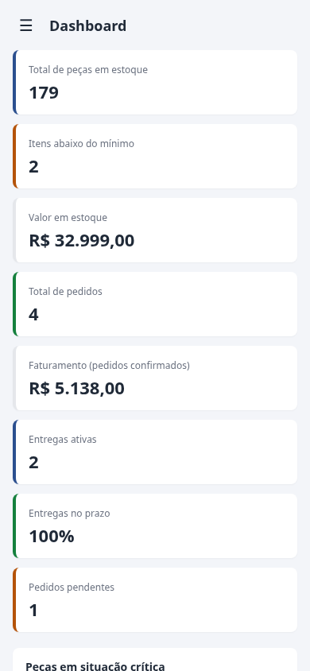

# 6. Interface do Sistema

Pré-requisitos: <a href="4-Projeto-Solucao.md"> Projeto da Solução</a>

As telas abaixo são da **versão inicial do aplicativo (v0.1.0)**, com os dados de demonstração após a execução do cenário de uso. O acesso é feito por login, e o menu lateral exibe apenas os módulos permitidos ao perfil do usuário (RF17). A interface se adapta a computadores e celulares (RNF06).

## 6.1. Tela principal do sistema

**Tela de acesso.** O usuário informa login e senha; o sistema identifica o perfil e libera apenas os módulos correspondentes.

**Painel gerencial.** Apresenta indicadores calculados a partir dos registros dos três módulos — itens abaixo do estoque mínimo, faturamento dos pedidos confirmados, entregas ativas, percentual de entregas concluídas no prazo, entre outros — e a lista de peças em situação crítica (RF05, RF18).

## 6.2. Telas do processo 1 — Gestão de Estoque

**Gerenciamento de estoque e movimentações.** Cada peça apresenta sua situação em relação ao estoque mínimo (OK, Crítico ou Zerado). A busca funciona por código, descrição ou aplicação. O histórico registra todas as movimentações, inclusive as saídas geradas automaticamente pelas vendas, com o pedido de origem e o usuário responsável (RF01, RF03, RF04, RF05, RNF09).

## 6.3. Telas do processo 2 — Pedido de Venda

**Acompanhamento de pedidos.** Lista os pedidos com sua situação e a da entrega. No exemplo, o pedido PED-2845 percorreu todo o fluxo integrado e foi concluído após a confirmação da entrega ENT-5418, enquanto o PED-2848 permanece pendente porque a quantidade solicitada excede o saldo disponível (RF07, RF09, RF11, RF16).

**Registro de novo pedido.** O vendedor seleciona o cliente e as peças, visualiza o saldo de cada item e o total calculado automaticamente, e pode salvar o pedido como pendente ou confirmá-lo imediatamente (RF07, RF08, RF10).

## 6.4. Telas do processo 3 — Expedição e Entrega

**Rastreamento de entregas.** A confirmação de um pedido gera a ordem de entrega exibida neste módulo. O responsável pela logística registra a saída, com o motorista, e a conclusão, com a comprovação do recebimento (RF12, RF14).

## 6.5. Versão para dispositivos móveis

