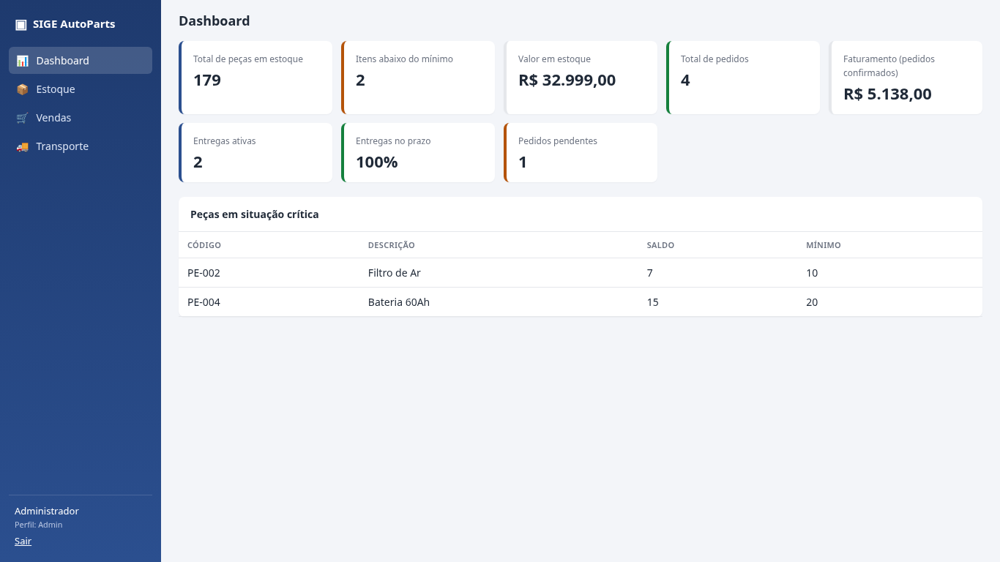

## 7. Indicadores de desempenho

Os indicadores permitem ao gestor acompanhar os processos integrados e comparar sua execução com objetivos definidos, considerando dimensões além da financeira (KAPLAN; NORTON, 1992). Todos são calculados pelo painel gerencial (RF18) a partir das tabelas do [modelo relacional](4-Projeto-Solucao.md#432-esquema-relacional), na função `indicadores` do serviço de integração. As metas indicadas são sugestões iniciais, a serem validadas pelo grupo após a avaliação da versão final.

| **Indicador** | **Objetivos** | **Descrição** | **Fonte de dados** | **Fórmula de cálculo** |
| ---           | ---           | ---           | ---             | ---             |
| Itens abaixo do estoque mínimo | Evitar a perda de vendas por falta de peça | Quantidade de peças cujo saldo está no estoque mínimo ou abaixo dele. Meta sugerida: 0 | Tabela `pecas` | contagem de peças com `quantidade <= estoque_minimo` |
| Itens zerados | Identificar rupturas de estoque | Quantidade de peças sem saldo. Meta sugerida: 0 | Tabela `pecas` | contagem de peças com `quantidade = 0` |
| Valor em estoque | Acompanhar o capital imobilizado em mercadorias | Valor total das peças em estoque | Tabela `pecas` | Σ (`quantidade` × `preco_unitario`) |
| Faturamento | Acompanhar o resultado das vendas | Soma do valor dos pedidos confirmados, em entrega ou concluídos | Tabela `pedidos` | Σ `valor_total` dos pedidos com status diferente de Pendente e Cancelado |
| Pedidos pendentes | Reduzir pedidos parados aguardando confirmação | Quantidade de pedidos ainda não confirmados | Tabela `pedidos` | contagem de pedidos com `status = 'Pendente'` |
| Entregas ativas | Dimensionar a carga da logística | Entregas pendentes ou em trânsito | Tabela `entregas` | contagem de entregas com `status <> 'Entregue'` |
| Taxa de entregas no prazo | Melhorar o nível de serviço ao cliente | Percentual das entregas concluídas até a data prevista. Meta sugerida: ≥ 90% | Tabela `entregas` | (entregas com `status = 'Entregue'` e `data_conclusao <= previsao` / total de entregas concluídas) × 100 |
| Total de pedidos | Acompanhar o volume de vendas | Quantidade de pedidos registrados | Tabela `pedidos` | contagem de pedidos |

### 7.1. Gráficos dos Indicadores de desempenho

Os indicadores são exibidos no painel gerencial da aplicação, atualizados a cada acesso:

> Gráficos com a evolução dos indicadores ao longo do tempo serão incluídos após a coleta de dados na avaliação da versão final.
