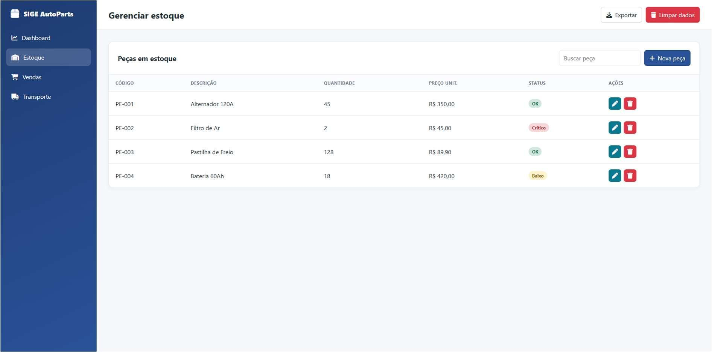
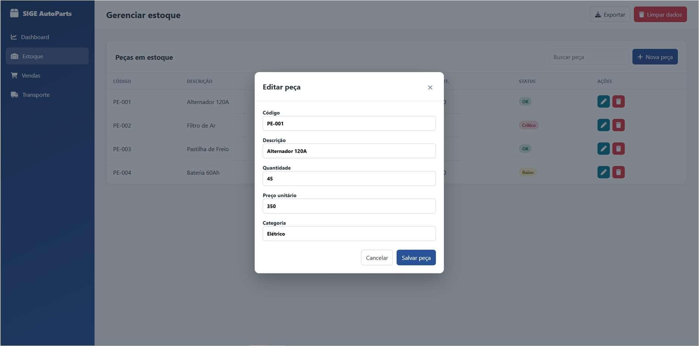

### 3.3.1 Processo 1 – GESTÃO DE ESTOQUE

O processo acontece no depósito da loja e é executado pelo **estoquista** (perfil Estoque) ou pelo **administrador**. Inicia-se quando uma peça precisa ser cadastrada ou quando ocorre uma movimentação fora da venda (recebimento de fornecedor, avaria, ajuste de inventário) e termina com o saldo atualizado e a movimentação registrada. As saídas por venda **não** passam por este processo: são geradas automaticamente pelo Processo 2.

Tarefas: cadastrar/editar peça; registrar entrada ou saída manual; consultar peças e situação do estoque (OK, Crítico, Zerado). Produtos: catálogo de peças atualizado e histórico de movimentações (RF01, RF03, RF04, RF05, RNF09).

##### 3.3.1.1 Modelagem BPMN

> Diagrama BPMN a ser elaborado na ferramenta da disciplina e inserido aqui (ex.: `../imagem/processo-1-bpmn.png`).

##### 3.3.1.2 Detalhamento das atividades do usuário (user tasks)

**Cadastrar / editar peça**

| **Campo**       | **Tipo**         | **Restrições** | **Valor default** |
| ---             | ---              | ---            | ---               |
| Código          | Caixa de texto   | obrigatório, único | |
| Categoria       | Caixa de texto   |                | |
| Descrição       | Caixa de texto   | obrigatório    | |
| Aplicação (veículos) | Caixa de texto | | |
| Preço unitário (R$) | Número       | obrigatório, ≥ 0 | |
| Estoque mínimo  | Número           | obrigatório, ≥ 0 | 5 |
| Quantidade inicial | Número        | ≥ 0; somente no cadastro | 0 |
| Fornecedor      | Seleção única    | fornecedores cadastrados | — |

| **Comandos**         |  **Destino**                   | **Tipo** |
| ---                  | ---                            | ---               |
| Salvar peça          | Lista de peças                 | default           |
| Cancelar             | Lista de peças                 | cancel            |

**Registrar movimentação (entrada/saída)**

| **Campo**       | **Tipo**         | **Restrições** | **Valor default** |
| ---             | ---              | ---            | ---               |
| Tipo            | Seleção única    | Entrada / Saída | Entrada |
| Quantidade      | Número           | obrigatório, ≥ 1; saída não pode deixar saldo negativo | |
| Motivo          | Caixa de texto   | ex.: compra de fornecedor, avaria, ajuste de inventário | |

| **Comandos**         |  **Destino**                   | **Tipo**          |
| ---                  | ---                            | ---               |
| Registrar            | Lista de peças (saldo atualizado) / Fim do processo | default |
| Cancelar             | Lista de peças                 | cancel            |

##### 3.3.1.3 Wireframes (user tasks)

