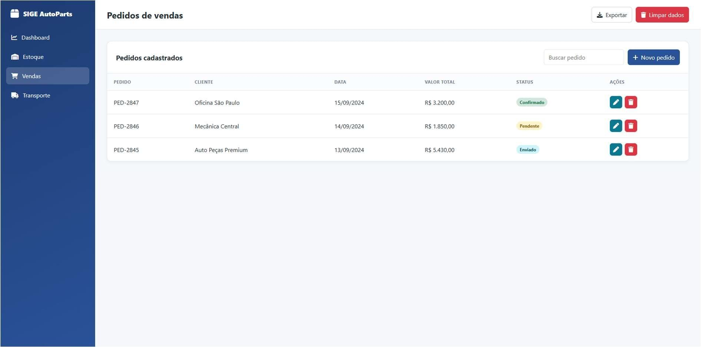
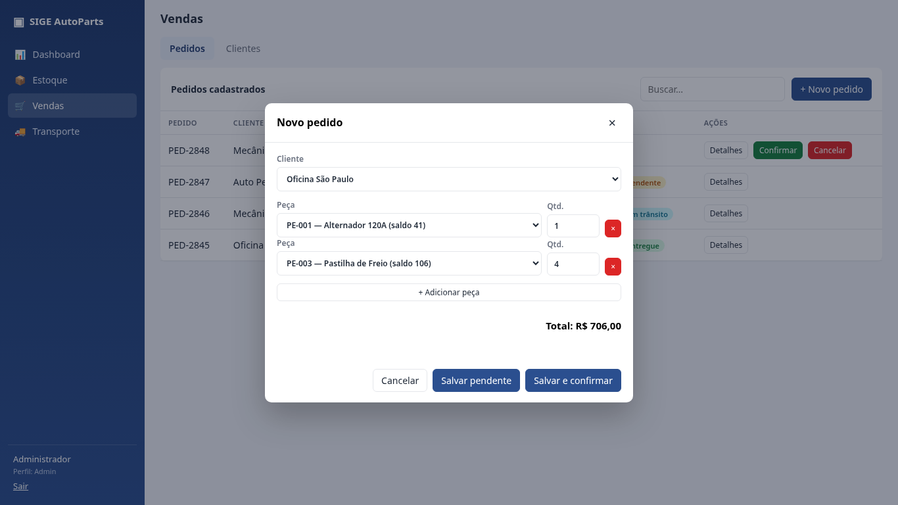

### 3.3.2 Processo 2 – REGISTRO E CONFIRMAÇÃO DE PEDIDO DE VENDA

O processo acontece no balcão/atendimento da loja e é executado pelo **vendedor** (perfil Vendas) ou pelo **administrador**. Inicia-se com a solicitação do cliente e termina com o pedido confirmado (estoque baixado e ordem de entrega gerada), salvo como pendente ou cancelado.

Tarefas: cadastrar/atualizar cliente; registrar pedido com um ou mais itens; verificar disponibilidade; confirmar ou cancelar pedido; acompanhar a situação do pedido e da entrega. Na confirmação, o sistema executa em **uma única transação** a verificação do saldo de cada item, a baixa no estoque, o registro da movimentação de saída e a geração da ordem de entrega; se algum item não tiver saldo, nada é alterado e o pedido permanece pendente (RF06 a RF12, RF15, RNF04).

Situações do pedido: Pendente → Confirmado → Em entrega → Concluído (ou Cancelado).

##### 3.3.2.1 Modelagem BPMN

> Diagrama BPMN a ser elaborado na ferramenta da disciplina e inserido aqui (ex.: `../imagem/processo-2-bpmn.png`).

##### 3.3.2.2 Detalhamento das atividades do usuário (user tasks)

**Cadastrar / editar cliente**

| **Campo**       | **Tipo**         | **Restrições** | **Valor default** |
| ---             | ---              | ---            | ---               |
| Nome / Razão social | Caixa de texto | obrigatório | |
| CPF/CNPJ        | Caixa de texto   | único          | |
| Telefone        | Caixa de texto   |                | |
| E-mail          | Caixa de texto   | formato de e-mail | |
| Endereço        | Caixa de texto   | usado como destino da entrega | |
| Cidade          | Caixa de texto   |                | |

| **Comandos**         |  **Destino**                   | **Tipo** |
| ---                  | ---                            | ---               |
| Salvar cliente       | Lista de clientes              | default           |
| Cancelar             | Lista de clientes              | cancel            |

**Registrar novo pedido**

| **Campo**       | **Tipo**         | **Restrições** | **Valor default** |
| ---             | ---              | ---            | ---               |
| Cliente         | Seleção única    | obrigatório; clientes cadastrados | |
| Itens do pedido | Tabela (Peça: seleção única; Qtd.: número ≥ 1) | ao menos um item; saldo exibido por peça | 1 item, Qtd. 1 |
| Total           | Número (calculado) | somente leitura; soma de quantidade × preço | |

| **Comandos**         |  **Destino**                   | **Tipo**          |
| ---                  | ---                            | ---               |
| + Adicionar peça     | Nova linha de item             |                   |
| Salvar pendente      | Lista de pedidos (Pendente)    |                   |
| Salvar e confirmar   | Confirmação do pedido → Processo 3 | default       |
| Cancelar             | Lista de pedidos               | cancel            |

**Confirmar / cancelar pedido pendente**

| **Comandos**         |  **Destino**                   | **Tipo**          |
| ---                  | ---                            | ---               |
| Detalhes             | Itens, saldo de cada item e situação da entrega | |
| Confirmar            | Baixa no estoque e início do Processo 3 (ou bloqueio por saldo insuficiente) | default |
| Cancelar             | Fim do processo (pedido Cancelado) | cancel        |

##### 3.3.2.3 Wireframes (user tasks)

