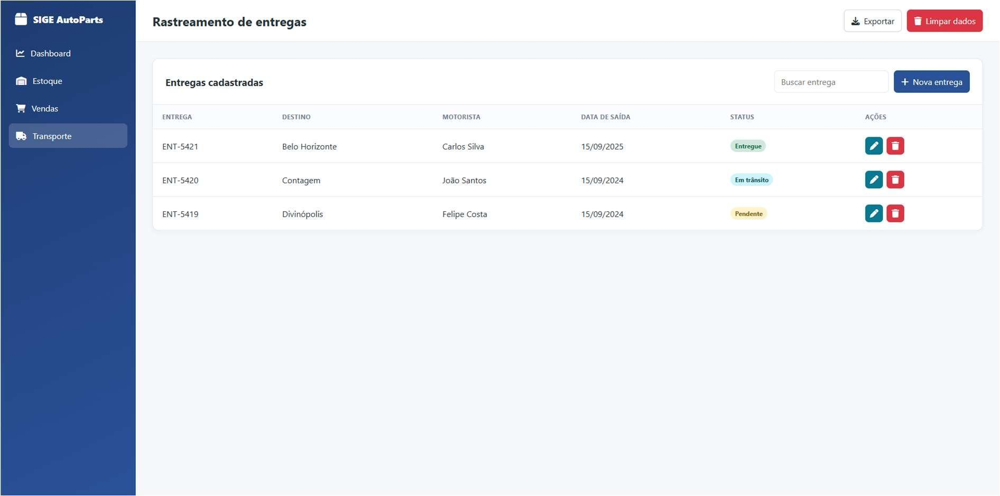
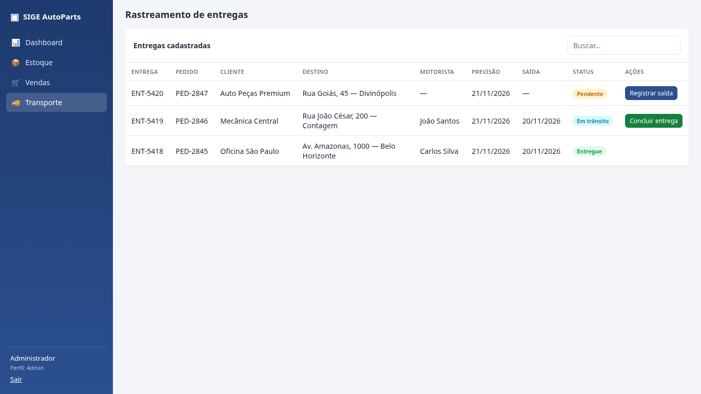

### 3.3.3 Processo 3 – EXPEDIÇÃO E ENTREGA

O processo é executado pelo **responsável pela logística** (perfil Logística) ou pelo **administrador**. Inicia-se automaticamente quando um pedido é confirmado no Processo 2, que gera a ordem de entrega com código, destino (endereço do cliente) e previsão (por padrão, dois dias após a confirmação). Termina com a entrega concluída e o pedido marcado como Concluído em Vendas.

Tarefas: consultar entregas; registrar a saída com o motorista; registrar a conclusão com a comprovação do recebimento. Cada mudança de situação é refletida automaticamente no pedido (Em trânsito → pedido "Em entrega"; Entregue → pedido "Concluído") (RF12, RF14, RF16).

Situações da entrega: Pendente → Em trânsito → Entregue.

##### 3.3.3.1 Modelagem BPMN

> Diagrama BPMN a ser elaborado na ferramenta da disciplina e inserido aqui (ex.: `../imagem/processo-3-bpmn.png`).

##### 3.3.3.2 Detalhamento das atividades do usuário (user tasks)

**Registrar saída da entrega**

| **Campo**       | **Tipo**         | **Restrições** | **Valor default** |
| ---             | ---              | ---            | ---               |
| Destino         | Caixa de texto   | somente leitura (endereço do cliente) | |
| Motorista       | Caixa de texto   | obrigatório    | |

| **Comandos**         |  **Destino**                   | **Tipo** |
| ---                  | ---                            | ---               |
| Confirmar saída      | Lista de entregas (Em trânsito) | default          |
| Cancelar             | Lista de entregas              | cancel            |

**Concluir entrega**

| **Campo**       | **Tipo**         | **Restrições** | **Valor default** |
| ---             | ---              | ---            | ---               |
| Cliente         | Caixa de texto   | somente leitura | |
| Comprovação     | Caixa de texto   | obrigatório (nome de quem recebeu / observação) | |

| **Comandos**         |  **Destino**                   | **Tipo**          |
| ---                  | ---                            | ---               |
| Concluir             | Fim do processo (entrega Entregue, pedido Concluído) | default |
| Cancelar             | Lista de entregas              | cancel            |

##### 3.3.3.3 Wireframes (user tasks)

